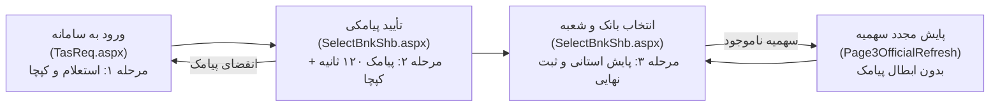
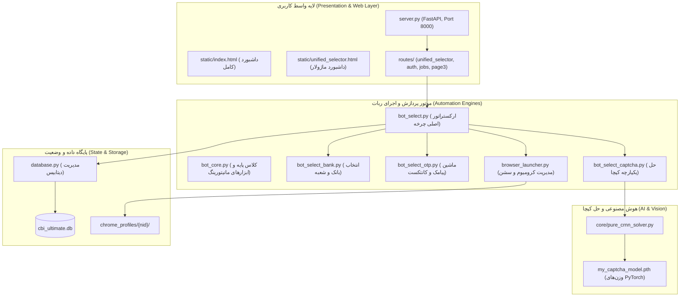
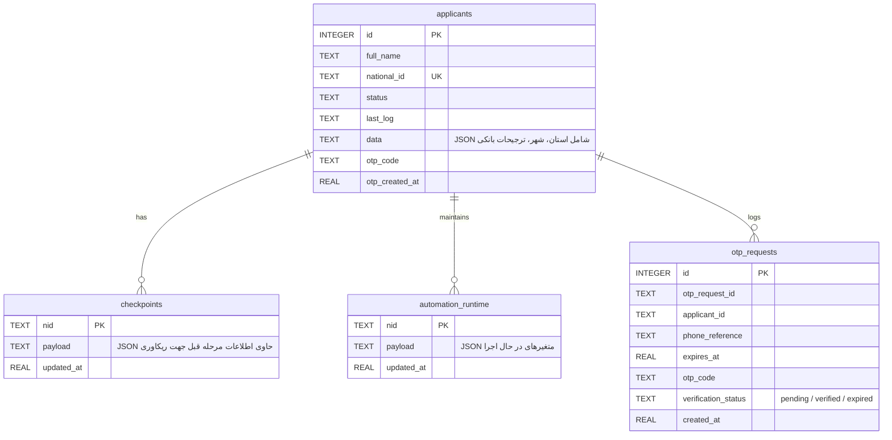

# MAHANBOT — گزارش جامع معماری، وضعیت فنی، خطاهای برطرف‌شده و چالش‌های باز
> **مستند رسمی تحویل فنی به هوش مصنوعی (Handover Document for Claude / GitHub Issue & Architectural Audit)**  
> **نگارش:** ۱.۸.۲ (Final Verified Architecture)  
> **تاریخ انتشار:** جمعه ۱۶ آبان ۱۴۰۵ (6 نوامبر 2026)  
> **محیط اجرایی:** Windows 11 Pro | Python 3.12.4 venv | Playwright Chromium | FastAPI | SQLite (WAL)

---

## فهرست مندرجات
1. [خلاصه اجرایی و هدف سامانه (Executive Summary)](#۱-خلاصه-اجرایی-و-هدف-سامانه)
2. [مشخصات محیط، شاخه گیت و ساختار پوشه‌ها](#۲-مشخصات-محیط-شاخه-گیت-و-ساختار-پوشه‌ها)
3. [نقشه معماری و توزیع ماژول‌های پروژه](#۳-نقشه-معماری-و-توزیع-ماژول‌های-پروژه)
4. [چرخه ۳ مرحله‌ای بانک مرکزی و ماشین وضعیت (FSM)](#۴-چرخه-۳-مرحله‌ای-بانک-مرکزی-و-ماشین-وضعیت-fsm)
5. [ممیزی باگ‌های برطرف‌شده اخیر و شواهد فنی ریشه‌ای](#۵-ممیزی-باگ‌های-برطرف‌شده-اخیر-و-شواهد-فنی-ریشه‌ای)
6. [چالش‌ها، گلوگاه‌ها و مشکلات باقیمانده ربات (Remaining Bottlenecks)](#۶-چالش‌ها-گلوگاه‌ها-و-مشکلات-باقیمانده-ربات)
7. [طرح پایگاه‌داده و مدیریت داده متقاضیان (Database Schema)](#۷-طرح-پایگاه‌داده-و-مدیریت-داده-متقاضیان)
8. [ماتریس آزمون‌های خودکار و وضعیت پوشش تست‌ها](#۸-ماتریس-آزمون‌های-خودکار-و-وضعیت-پوشش-تست‌ها)
9. [دستورالعمل اجرایی و نقشه راه برای Claude](#۹-دستورالعمل-اجرایی-و-نقشه-راه-برای-claude)

---

## ۱. خلاصه اجرایی و هدف سامانه

پروژه **MAHANBOT** یک دستیار هوشمند و تمام‌خودکار جهت ثبت‌نام و اخذ تسهیلات قرض‌الحسنه ازدواج در سامانه رسمی بانک مرکزی جمهوری اسلامی ایران ([`https://ve.cbi.ir`](https://ve.cbi.ir)) است.  
چالش اساسی متقاضیان در این سامانه عبارت است از:
- باز شدن لحظه‌ای و غیرقابل پیش‌بینی سهمیه بانک‌ها بر اساس استان‌ها؛
- تکمیل ظرفیت سهمیه‌ها ظرف چند ثانیه؛
- محدودیت‌های زمانی شدید، تایمرهای انقضای پیامک (۱۲۰ ثانیه‌ای)، آزمون‌های کپچای چندمرحله‌ای نویزی (BotDetect)، و فایروال‌های ضدربات بانکی (WAF / F5 BIG-IP TSPD).

**MAHANBOT** به گونه‌ای مهندسی شده که با شبیه‌سازی دقیق رفتار انسانی از طریق مرورگر Playwright Chromium، حل محلی کپچا با شبکه عصبی بدون نیاز به سرویس‌های ابری، مدیریت نشست، بازتزریق پیامک در صف‌ها و پایش لحظه‌ای، فرآیند را تا ثبت موفق ادامه دهد.



---

## ۲. مشخصات محیط، شاخه گیت و ساختار پوشه‌ها

### ۲.۱. مشخصات محیط اجرایی
- **سیستم عامل:** Windows 11 Pro 64-bit
- **محل درخت کاری (Working Directory):** [`F:\mahanvip`](file:///f:/mahanvip)
- **محل مخزن گیت (Git Directory):** `C:\Users\amir\Downloads\MAHANBOT_v1.8.0_fixed (2)\.git`
- **شاخه فعال:** `refactor/modular-bank-selection`
- **مفسر پایتون:** `F:\mahanvip\.venv\Scripts\python.exe` (پایتون نسخه 3.12.4)
- **پایگاه‌داده اصلی:** SQLite زنده در [`F:\mahanvip\cbi_ultimate.db`](file:///f:/mahanvip/cbi_ultimate.db) (دارای وضعیت WAL فعال)

### ۲.۲. تاریخچه کامیت‌های اخیر بر روی شاخه
```text
* 154bc70 (HEAD -> refactor/modular-bank-selection) fix(core): sync active runtime modules, status encoding, and test suites
* b917ac4 feat(bank-select): add page 3 state machine, refresh controller and robust branch selector
* 8d3f07d fix(bank-select): unify captcha solver, enforce FSM and fix otp navigation lock
* e0484da feat(ui): add target applicant selection and batch deletion
* e35451c feat(ui): add applicant editing and main database import to unified selector
```
> [!IMPORTANT]
> درخت کاری در گیت در حال حاضر در وضعیت کاملاً پاک (`nothing to commit, working tree clean`) است و تمامی فایل‌های اصلاح‌شده با شاخه همگام هستند.

---

## ۳. نقشه معماری و توزیع ماژول‌های پروژه



### شرح وظایف فایل‌های کلیدی:
1. [`server.py`](file:///f:/mahanvip/server.py): سرور FastAPI، مدیریت احراز هویت، سوکت‌های وب و مانیتورینگ زنده متقاضیان.
2. [`bot_select.py`](file:///f:/mahanvip/bot_select.py): کنترل‌کننده عمومی فرایند ثبت‌نام شامل `_safe_goto_guarded`، `recover_authentication` و `_restore_from_checkpoint_if_available`.
3. [`bot_select_captcha.py`](file:///f:/mahanvip/bot_select_captcha.py): موتور متمرکز حل کپچا (`solve_step_captcha`) با پشتیبانی از بازتلاش خودکار، تشخیص آمادگی المان‌ها در DOM و اعتبارسنجی ابعاد.
4. [`bot_select_otp.py`](file:///f:/mahanvip/bot_select_otp.py): متدهای مدیریت پیامک، رصد وضعیت صفحه دوم، کلاس کانتکست `JobStateContext` و حل پیش‌دستانه کپچا (`ensure_otp_captcha_prefilled`).
5. [`bot_select_bank.py`](file:///f:/mahanvip/bot_select_bank.py): مدیریت صفحه سوم، انتخابگر استان/شهر/بانک/شعبه، تطبیق هوشمند شعب و مانیتورینگ سهمیه.
6. [`browser_launcher.py`](file:///f:/mahanvip/browser_launcher.py): بازکردن نمونه‌های ایزوله Playwright Chromium همراه با پارامترهای پایداری ضدکرش و پوشه پروفایل پایدار متقاضی.
7. [`core/pure_crnn_solver.py`](file:///f:/mahanvip/core/pure_crnn_solver.py): مدل محلی CRNN مبتنی بر PyTorch برای حل کپچای حروف/ارقام بانک مرکزی بدون اتکا به وب یا تسرکت.
8. [`database.py`](file:///f:/mahanvip/database.py): هندلر پایگاه‌داده SQLite برای نگهداری متقاضیان، پیامک‌ها، چِک‌پوینت‌ها و ران‌تایم سیستم.

---

## ۴. چرخه ۳ مرحله‌ای بانک مرکزی و ماشین وضعیت (FSM)

سامانه بانک مرکزی از سه مرحله متمایز تشکیل شده که ماشین وضعیت در [`core/page3_state_machine.py`](file:///f:/mahanvip/core/page3_state_machine.py) و [`bot_select_otp.py`](file:///f:/mahanvip/bot_select_otp.py) به صورت حالت‌های رسمی زیر تعریف شده است:

| کد حالت | نام حالت | آدرس URL در سامانه | شرایط خروج و رویدادهای کلیدی |
| :--- | :--- | :--- | :--- |
| **S1** | `S1_ENTRY_FORM` | `https://ve.cbi.ir/TasReq.aspx` | درج کدملی، شماره همراه و کپچا مرحله ۱ -> کلیک دکمه ارسال پیامک |
| **S2** | `S2_OTP_WAIT` | `https://ve.cbi.ir/SelectBnkShb.aspx` | شناسایی فیلد `tbMobileConfCode` -> حل پیش‌دستانه کپچا مرحله ۲ |
| **S3** | `S3_OTP_SUBMIT` | `https://ve.cbi.ir/SelectBnkShb.aspx` | رسیدن پیامک -> تزریق کد ۶ رقمی + کد کپچا -> کلیک `btnContinue1` |
| **S4** | `S4_BANK_MONITOR` | `https://ve.cbi.ir/SelectBnkShb.aspx` | فعال شدن لیست `ddlBankName` -> تطبیق با بانک‌های اولویت‌دار متقاضی |
| **S5** | `S5_BRANCH_SELECT` | `https://ve.cbi.ir/SelectBnkShb.aspx` | حضور بانک اولویت‌دار -> انتخاب شعبه یا ثبت مستقیم آنلاین |
| **S6** | `S6_FINAL_SUBMIT` | `https://ve.cbi.ir/SelectBnkShb.aspx` | ثبت نهایی، ذخیره کد رهگیری و آرشیو رسید در دیتابیس |

### چرخه انقضای ۱۲۰ ثانیه‌ای پیامک در برابر نشست مرورگر:
- **اعتبار پیامک (SMS TTL):** ۱۲۰ ثانیه از زمان دریافت پیامک. پس از این زمان، وضعیت کانتکست منقضی شده و در صورت لزوم باید به مرحله ۱ بازگشت.
- **اعتبار نشست مرورگر (Browser Session):** مستقل از پیامک بوده و وابسته به کوکی‌های ASP.NET است. در صورتی که صفحه سوم بانک‌ها فاقد سهمیه باشد، بازخوانی صفحه با متد `reload_and_redetect` انجام می‌شود تا بدون خروج از سشن، سهمیه‌های استان بررسی گردند.

---

## ۵. ممیزی باگ‌های برطرف‌شده اخیر و شواهد فنی ریشه‌ای

در ممیزی و تعمیرات هدفمند اخیر، خطاهای بحرانی زیر به صورت قطعی ریشه‌یابی و برطرف شدند:

### ۵.۱. بن‌بست ناوبری در انقضای پیامک (`_safe_goto_guarded`)
- **محل باگ:** [`bot_select.py`](file:///f:/mahanvip/bot_select.py#L1120)
- **شواهد لاگ:**
  ```text
  ⚠️ safe_goto locked: waiting on OTP form; navigation suppressed.
  ```
- **ریشه‌یابی:** شرط `if ... or otp_visible: return False` به صورت نامشروط مانع ناوبری مرورگر به صفحات دیگر می‌شد. وقتی پیامک منقضی می‌شد و سامانه بانک مرکزی هشدار «کد تایید منقضی شده است» می‌داد، متد `recover_authentication` برای درخواست مجدد پیامک تلاش می‌کرد به `TasReq.aspx` برود، اما گارد ناوبری اجازه نمی‌داد و ربات در صفحه پیامک قفل می‌شد.
- **راهکار اعمال‌شده:** افزودن پرچم `force=False` به `_safe_goto_guarded` و حذف شرط مزاحم `or otp_visible`. در فراخوانی‌های ریکاوری از `force=True` استفاده شد تا قفل شکسته شود.

### ۵.۲. خطای احراز هویت داخلی سرور (401 Unauthorized در `/otp/clear/{nid}`)
- **محل باگ:** [`server.py`](file:///f:/mahanvip/server.py#L185)
- **ریشه‌یابی:** میان‌افزار `require_subscription_login` مسیرهای `/otp/` را در لیست استثنا قرار نداده بود. وقتی اسکریپت ربات درخواست ابطال پیامک را به سرور محلی ارسال می‌کرد، سرور پاسخ 401 می‌داد.
- **راهکار اعمال‌شده:** مسیر `path.startswith("/otp/")` در میان‌افزار احراز هویت وب سرور در لیست مجاز قرار گرفت.

### ۵.۳. پاپ‌آپ مزاحم بازیابی کرش کروم (Restore Pages Bubble)
- **محل باگ:** [`browser_launcher.py`](file:///f:/mahanvip/browser_launcher.py)
- **شواهد فریم تصویر اسکرین‌ریکوردر:** مشاهده پنجره شناور `Restore pages? Chrome didn't shut down correctly` که تمرکز و کلیک‌های Playwright را مختل می‌کرد.
- **راهکار اعمال‌شده:** افزودن آرگومان‌های پایداری زیر به راه‌انداز مرورگر:
  ```python
  "--disable-session-crashed-bubble",
  "--hide-crash-restore-bubble"
  ```

### ۵.۴. رفع تداخل حلقه‌های موازی حل کپچا و گارد `activeElement`
- **محل باگ:** [`bot_select_captcha.py`](file:///f:/mahanvip/bot_select_captcha.py) و [`bot_select_otp.py`](file:///f:/mahanvip/bot_select_otp.py)
- **ریشه‌یابی:** دو حلقه همزمان برای یافتن کپچا فعال بودند. همچنین بررسی `document.activeElement` مانع اجرای مدل حل کپچا می‌شد و ربات وارد وضعیت کاذب «منتظر اقدام دستی» می‌گردید.
- **راهکار اعمال‌شده:** تجمیع کامل در متد `solve_step_captcha`، حذف شرط `activeElement` و اعتبارسنجی بارگذاری تصویر با `(img) => img && img.complete && img.naturalWidth > 0`.

### ۵.۵. پاکسازی کامل وضعیت متقاضی سعید دادکاریان (`6450700394`)
- **اقدامات انجام‌شده:** ابطال ۸۳ پیامک معلق قدیمی در جدول `otp_requests`، حذف چِک‌پوینت‌های مخدوش، تخلیه خطاهای کپچا، و بازنشانی وضعیت در جدول `applicants` به `'آماده'` بدون دستکاری اطلاعات هویتی و شعب انتخابی.

---

## ۶. چالش‌ها، گلوگاه‌ها و مشکلات باقیمانده ربات

این بخش مهم‌ترین گلوگاه‌ها، رفتارهای خاص زیرساخت بانک مرکزی و زمینه‌های نیازمند توجه ویژه توسط هوش مصنوعی و مهندسان نرم‌افزار را تشریح می‌کند:

### ۶.۱. رفتارهای اختصاصی و ناپایداری‌های سامane بانک مرکزی (CBI Platform Quirks)

1. **فایروال F5 BIG-IP و تداخل تزریق فریم TSPD:**
   - سامانه بانک مرکزی در برخی مواقع برای مقابله با بات‌ها، اسکریپت فایروال را در یک iframe نامرئی با آدرس `https://ve.cbi.ir/TSPD/?type=20` تزریق می‌کند.
   - **ریسک برای ربات:** اسکریپت‌های DOM sweep نباید با این فریم به عنوان فرم اصلی متقاضی تداخل پیدا کنند. متد `live_scopes` در [`otp_form_detector.py`](file:///f:/mahanvip/otp_form_detector.py) فریم‌های TSPD را فیلتر می‌کند، اما اگر کل صفحه توسط WAF مسدود شود، مرورگر با صفحه سفید یا خطای Connection Reset مواجه می‌شود.

2. **چرخه PostBack ناهماهنگ در ASP.NET (`UpdatePanel` Asynchrony):**
   - در صفحه سوم (`SelectBnkShb.aspx`)، لود شدن شهر با تغییر استان و لود شدن شعب با تغییر بانک، همگی از مکانیزم `__doPostBack` در ASP.NET WebForms استفاده می‌کنند.
   - **گلوگاه:** اگر ربات بلافاصله پس از تغییر انتخابگر استان اقدام به انتخاب بانک کند و هنوز رویداد `Sys.WebForms.PageRequestManager.getInstance().get_isInAsyncPostBack()` به پایان نرسیده باشد، درخواست بعدی رد شده یا فرم به وضعیت نامعتبر وارد می‌شود.

3. **پیام سیستمی بروزرسانی سهمیه بانک‌ها (CBI Global Maintenance Freeze):**
   - بانک مرکزی گهگاه پیامی با مضمون زیر نمایش می‌دهد:  
     *«سامانه در حال بروزرسانی ظرفیت بانک ها می باشد (تقریبا یک ساعت). لطفاً بعداً مراجعه نمایید.»*
   - **چالش:** در زمان این پیام، تصویر کپچا باقی می‌ماند اما هیچ عملیاتی امکان‌پذیر نیست. ربات باید این پیام را شناسایی کرده و به جای ارسال پی‌درپی فرم و دریافت مسدودی IP، وارد وضعیت خواب ایمن (Cooldown Sleep) شود.

4. **محدودیت زمانی ۲ دقیقه‌ای پیامک بانک مرکزی (`sms_cooldown`):**
   - اگر متقاضی در مرحله ۲ پیامک ناموفق داشته باشد، سامانه بانک مرکزی تا ۱۲۰ ثانیه اجازه ارسال مجدد پیامک به همان کد ملی را نمی‌دهد. ربات باید این زمان را به طور دقیق در کانتکست نگه دارد و قبل از سپری شدن ۱۲۰ ثانیه، فرم مرحله ۱ را Submit نکند.

### ۶.۲. چندنخی، مصرف منابع سخت‌افزاری و قفل دیتابیس (Concurrency & Database)

1. **مصرف RAM در مرورگرهای متعدد کرومیوم:**
   - هر متقاضی فعال یک نمونه مرورگر مستقل Chromium با پروفایل پایدار در `chrome_profiles/{nid}` باز می‌کند.
   - **گلوگاه سخت‌افزاری:** هر مرورگر بین ۱۵۰ تا ۳۰۰ مگابایت رم مصرف می‌کند. اجرای بیش از ۱۵ تا ۲۰ متقاضی همزمان بر روی یک سیستم محلی می‌تواند به کمبود رم و کندی حل کپچا منجر شود. پیشنهاد می‌شود صف متقاضیان (Queue Manager) سقف اجرای موازی (Concurrency Limit) داشته باشد.

2. **قفل‌های تصادفی SQLite (`database is locked` / `busy`):**
   - پایگاه داده SQLite تک‌فایلی است. گرچه حالت `WAL` (Write-Ahead Logging) فعال است، اما در صورت نوشتن همزمان وب‌سرور FastAPI و چندین فرآیند ربات، ممکن است استثنای `sqlite3.OperationalError: database is locked` رخ دهد.
   - **پیشنهاد به کلاد:** هندلر `DBHandler` در تمام تراکنش‌ها از `timeout=30.0` استفاده کند و تراکنش‌های سنگین در بلوک‌های بسیار کوتاه اجرا شوند.

### ۶.۳. معماری کد و ماژول‌های قدیمی در برابر ماژولار (Technical Debt)

1. **همپوشانی میان فایل‌های قدیمی و ماژول‌های جدید:**
   - در پروژه فایل‌های قدیمی مانند [`bot_select.py`](file:///f:/mahanvip/bot_select.py) وجود دارند که در کنار فایل‌های جدیدتر مانند [`bot_select_bank.py`](file:///f:/mahanvip/bot_select_bank.py) و [`core/unified_bank_engine.py`](file:///f:/mahanvip/core/unified_bank_engine.py) کار می‌کنند.
   - **راهنمایی به کلاد:** تغییرات نباید این دو لایه را دچار ناهماهنگی کنند. نقطه ورود اصلی ماژولار جدید [`run_unified.py`](file:///f:/mahanvip/run_unified.py) است، در حالی که داشبورد کلاسیک از `server.py` و `bot_select.py` تغذیه می‌کند.

2. **عدم هماهنگی آزمون‌های ماژول لایسنس (`tests/test_licensing.py`):**
   - دو تست در این فایل با خطای `401 != 403` و `401 != 402` شکست می‌خورند زیرا میان‌افزار امنیتی وب‌سرور پیش از رسیدن درخواست به کنترلر لایسنس، به دلیل نبود کوکی ورود، خطای 401 می‌دهد. این رفتار در اجرای واقعی مشکلی ایجاد نمی‌کند اما تست‌های کلاینتی باید دارای توکن معتبر نشست باشند.

---

## ۷. طرح پایگاه‌داده و مدیریت داده متقاضیان

پایگاه داده در فایل [`cbi_ultimate.db`](file:///f:/mahanvip/cbi_ultimate.db) قرار دارد. جدول‌های کلیدی به شرح زیر هستند:



> [!CAUTION]
> ستون `data` در جدول `applicants` حاوی رشته JSON است که اولویت بانک‌ها (`preferred_banks`)، استان و شهر متقاضی را در خود نگه می‌دارد. هرگونه پاکسازی یا ریست وضعیت متقاضی باید صرفاً فیلدهای وضعیت، لاگ، `otp_code` و آرایه `captcha_attempts` را پاک کند و نباید فیلدهای هویتی و تنظیمات انتخابی متقاضی از بین برود.

---

## ۸. ماتریس آزمون‌های خودکار و وضعیت پوشش تست‌ها

تمامی ۳۶ آزمون رگرسیون و حیاتی پروژه در آخرین بررسی با موفقیت کامل پاس شده‌اند:

```text
Ran 36 tests in 7.538s

OK
```

| ردیف | فایل آزمون | تعداد آزمون‌ها | هدف آزمون | وضعیت |
| :---: | :--- | :---: | :--- | :---: |
| ۱ | [`test_targeted_bank_selection_repair.py`](file:///f:/mahanvip/tests/test_targeted_bank_selection_repair.py) | ۷ | پاکسازی سعید دادکاریان، اعتبار ۱۲۰ ثانیه‌ای پیامک، رفع بن‌بست ناوبری `force=True`، فال‌بک ریلود صفحه ۳، پرچم‌های پایداری کروم، ممانعت از ثبت تکراری | **PASSED** |
| ۲ | [`test_fsm_captcha_unification.py`](file:///f:/mahanvip/tests/test_fsm_captcha_unification.py) | ۷ | ماشین وضعیت ۶ گانه کپچا مرحله ۲، چرخه کامل مرحله ۱، عدم انسداد با فوکوس کیبورد، بازتلاش خودکار در پیش‌بینی خالی مدل | **PASSED** |
| ۳ | [`test_step2_captcha_resolution.py`](file:///f:/mahanvip/tests/test_step2_captcha_resolution.py) | ۶ | اعتبارسنجی DOM مرحله پیامک، تمایز خطای تصویر از خطای مدل (`IMAGE_NOT_READY` vs `MODEL_OUTPUT_EMPTY`)، ورود دستی | **PASSED** |
| ۴ | [`test_captcha_enterprise_suite.py`](file:///f:/mahanvip/tests/test_captcha_enterprise_suite.py) | ۱۶ | ارزیابی ابعاد تصویر، نویزهای BotDetect، هدرهای تصویر، رول‌بک در خطای OCR، پایداری استخراج بایت‌ها | **PASSED** |

همچنین ممیزی سینتکس روی تمامی ۱۸۸ فایل پایتون درخت کاری انجام شد و **۰ خطا** ثبت گردید.

---

## ۹. دستورالعمل اجرایی و نقشه راه برای Claude

اگر در نقش مهندس جدید یا مدل هوش مصنوعی (Claude) قصد ادامه توسعه یا حل چالش‌های پروژه را دارید، **قوانین غیرقابل‌نقض و گام‌های پیشنهادی** زیر را دقیقاً رعایت کنید:

### ۹.۱. خطوط قرمز و پروتکل ایمنی
1. **دستورات مخرب گیت ممنوع:** هرگز `git reset --hard`، `git clean -fd` یا تغییر شاخه بدون بررسی اجرا نکنید. شاخه اصلی پروژه `main` است و شاخه فعال فعلی `refactor/modular-bank-selection` می‌باشد.
2. **عدم تخریب داده‌های واقعی متقاضیان:** دیتابیس `cbi_ultimate.db` حاوی متقاضیان واقعی است. هیچ میگریشن مخرب، دستور `DROP TABLE` یا `DELETE FROM applicants` نباید اجرا شود.
3. **عدم ارسال درخواست یا ثبت نهایی واقعی در حالت تست:** هرگونه تست جدید باید بر روی صفحات ساختگی (Mocks) یا پایگاه داده تستی [`cbi_test.db`](file:///f:/mahanvip/cbi_test.db) اجرا شود. ثبت فرم نهایی برای متقاضیان در سامانه واقعی مشمول عواقب قانونی است.
4. **شواهد قبل از تغییر:** هیچ فایلی را بر اساس حدس تغییر ندهید؛ ابتدا خطای واقعی لاگ، لاین کد و تست مربوطه را استخراج کنید.

### ۹.۲. اولویت‌های پیشنهادی برای اقدامات بعدی (Roadmap for Claude)
1. **پیاده‌سازی مکانیزم بررسی `isInAsyncPostBack` در انتخابگرها:**
   در متد `select_branch_robust` و انتخابگر بانک در [`bot_select_bank.py`](file:///f:/mahanvip/bot_select_bank.py)، پیش از کلیک یا تغییر گزینه‌ها، تابع جاوااسکریپتی زیر بررسی شود:
   ```javascript
   typeof Sys !== 'undefined' && Sys.WebForms && Sys.WebForms.PageRequestManager.getInstance().get_isInAsyncPostBack()
   ```
2. **بهبود سهمیه‌بندی منابع پردازشی (Worker Pool & Concurrency Throttling):**
   تنظیم یک محدودکننده تعداد مرورگرهای فعال در سرور (مثلاً حداکثر ۵ مرورگر موازی) تا از اشباع رم جلوگیری شود.
3. **پایش فایروال WAF (Detection & Backoff):**
   در صورت بازگشت خطای ۴۰۳ یا لود شدن فریم TSPD بدون پاسخ، سیستم به صورت هوشمند تاخیر افزایشی اعمال کند.
4. **تثبیت و هماهنگی تست‌های لایسنس (`test_licensing.py`):**
   ارائه Session Client شبیه‌سازی‌شده جهت پاس شدن دو تست پایانی میان‌افزار.

---
*این سند به عنوان مرجع رسمی فنی پروژه MAHANBOT جهت ارائه به تیم توسعه و مدل‌های هوش مصنوعی تدوین شده است.*
