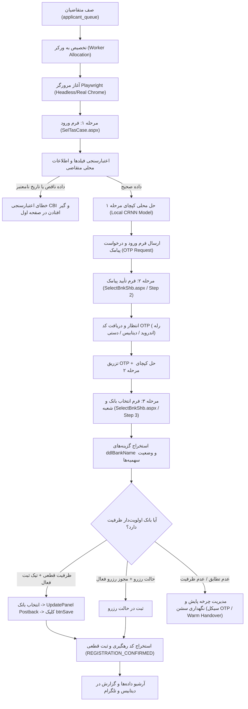

# گزارش ممیزی جامع معماری و تحلیل ریشه مشکلات MAHANBOT
**تاریخ تدوین:** ۲۹ فوریه ۲۰۲۶ / ۱۰ آبان ۱۴۰۳  
**مخزن:** `MAHANBOT_v1.8.0_fixed`  
**شاخه کاری:** `refactor/unify-mahanbot-architecture`  
**وضعیت:** مصوب فاز ۱ مأموریت بازسازی و یکپارچه‌سازی  

---

## ۱. نقشه کلان معماری و جریان چرخه حیات متقاضی (Applicant Lifecycle)

چرخه حیات هر متقاضی در سامانه از لحظه ورود تا ثبت قطعی در نمودار زیر مستند شده است:

---

## ۲. گلوگاه‌های شناسایی‌شده و تحلیل ریشه‌ای مشکلات

### ۲.۱. پراکندگی و افزونگی شدید در ماژول‌های انتخاب بانک (Task 2 Root Cause)
منطق انتخاب بانک، تطبیق نام‌های فارسی، نرمال‌سازی متون، استخراج سهمیه و پردازش پاسخ سرور به صورت نامنظم در چندین فایل حجیم تکرار شده است:
1. `bot_select_bank.py` (۲,۴۲۶ سطر): شامل منطق پیچیده `process_bank_selection_v2`، نرمال‌سازی‌های دستی متنی، ذخیره صفحات و مچینگ بانک.
2. `bank_session_controller.py` (۸۱۶ سطر): مدیریت چرخه سشن، پایش سهمیه‌ها، رله تلگرام و بازگشت به چرخه OTP.
3. `bank_page_manager.py` (۴۷۰ سطر): استخراج DOM، کلاسیفای کردن وضعیت ظرفیت و نرمال‌سازی متون.
4. `bank_quota_sniper.py` (۱۷۶ سطر): سابمیت تک‌فرصتی در لحظه باز شدن سهمیه.
5. `core/step3_bank_page.py` (۴۸۳ سطر): کلاس شیءگرا برای ارتباط مستقیم با صفحه ۳، غیرفعال‌سازی ترپ خروج و خواندن گزینه‌ها.
6. `core/persian_normalizer.py` (۱۷۴ سطر) و `core/bank_matcher.py` (۲۸۲ سطر): نرمال‌سازی متنی و تطبیق اولویت‌ها.

**مجموع سطور کد انتخاب بانک:** بالغ بر **۴,۸۰۰ سطر** با چندین نگارش متفاوت از توابع نرمال‌سازی (`_normalize_persian` در برابر `normalize_name` و `normalize_text`).

### ۲.۲. مشکل رفرش صفحه سوم و ارتباط آن با کپچای مرحله پیامک (User Bug Root Cause)
- **مشاهده رفتاری کاربر:** پس از عدم یافتن سهمیه در صفحه ۳، مرورگر رفرش می‌شد و به مرحله پیامک/کپچا برمی‌گشت و کپچا دیگر حل نمی‌شد.
- **ریشه فنی:** در `bank_session_controller.py`، متد `evaluate_and_execute_bank_logic` در صورت عدم تطابق، متد `page.reload()` را صدا می‌زد و به وضعیت `cycle_otp` بازمی‌گشت.
- در این حالت:
  1. سشن ASP.NET روی سرور CBI به صفحه تأیید OTP منتقل می‌شد، اما مقادیر پنهان `__VIEWSTATE` و `__EVENTVALIDATION` بازنشانی می‌شدند.
  2. کد پیامک قبلی در دیتابیس علامت‌گذاری نشده بود یا زمان انقضای ۱۱۵ ثانیه‌ای آن در نظر گرفته نشده بود.
  3. به دلیل فراخوانی‌های متوالی حل کپچا با پارامترهای ناقص یا ناسازگار، خطای `TypeError` رخ می‌داد یا کپچا بدون تغییر تصویر مجدداً به مدل داده می‌شد.

### ۲.۳. ریشه خطای کپچا در مورد دو متقاضی خاص (سعید دادکاریان و مریم آسکانی)
بررسی مستقیم دیتابیس `cbi_ultimate.db` ریشه قطعی شکست این دو متقاضی را آشکار کرد:
1. **مریم آسکانی (`7040099756`):**
   - در فیلد `applicants.data`، فیلدهای حیاتی شامل `birth_d`, `birth_m`, `birth_y`, `marriage_d`, `marriage_m`, `marriage_y` و `mobile` همگی رشته خالی `""` بودند و `loan_type` برابر `None` بود.
   - هنگام اجرای ربات، فرم مرحله ۱ با مقادیر خالی پر می‌شد. سرور CBI خطای ولیدیشن فارسی می‌داد و در همان فرم ورود باقی می‌ماند. ربات این توقف را به عنوان «خطای کپچا» تلقی کرده و کپچا را بارها تکرار می‌کرد.
2. **سعید دادکاریان (`6450700394`):**
   - تاریخ ازدواج در دیتابیس برابر با `1405/02/20` (سال ۱۴۰۵ در آینده!) ثبت شده بود.
   - سامانه CBI به صورت سمت کلاینت/سرور تاریخ‌های آینده را رد می‌کند و اجازه گذر به مرحله ۲ را نمی‌دهد؛ در نتیجه ربات ۱۱۵ بار کپچا را حل و ارسال می‌کرد اما سامانه به مرحله بعد نمی‌رفت.

### ۲.۴. گلوگاه‌های زمانی (Sleeps, Polling & DOM Inefficiencies)
- استفاده از تاخیرهای مصنوعی مانند `BrowserActions.human_fill` با `random.uniform(0.15, 0.45)` در مرحله حساس کپچا، تا ۵۰۰ میلی‌ثانیه به هر تلاش اضافه می‌کرد.
- عدم استفاده از سیگنال‌های مستقیم ASP.NET WebForms (`PageRequestManager`) و اتکا به تایم‌اوت‌های ایستا یا رفرش کامل مرورگر.
- بارگذاری مجدد مدل استنتاج یا اسکرین‌شات دیسکی (که در اصلاحیه قبلی با مدل سینگلتون CPU و اسکرین‌شات در حافظه حل شد، اما نیاز به تثبیت ساختاری در فریم‌ورک واحد دارد).

---

## ۳. جدول وضعیت و اجزای معماری جدید (Unified Target State)

| ماژول هدف | مسئولیت واحد | جایگزین کدهای قبلی |
| :--- | :--- | :--- |
| `BankSelectionOrchestrator` | مدیریت یکپارچه جریان صفحه سوم و کنترل چرخه حیات سشن | ادغام `bank_session_controller.py` و بخش‌های نظارتی `bot_select_bank.py` |
| `PersianBankMatcher` | استانداردسازی قطعی نام بانک‌ها، رتبه‌بندی و حل ابهام (مانند توسعه صادرات vs صادرات) | یکسان‌سازی ۳ تابع نرمال‌سازی متنی پراکنده |
| `BankCatalogParser` | استخراج دقیق ساختار سهمیه‌ها، سهمیه قطعی، رزرو و تعداد صف | تجمیع `parse_bank_dropdown_html` و `read_live_bank_options` |
| `BankQuotaClassifier` | تفکیک انواع خطا، ظرفیت پر، مسدودیت امنیتی و تاییدیه ثبت | تفکیک منطق در `bank_page_manager.py` |
| `PostbackSynchronizer` | پایش همگام‌سازی ناهمگام ASP.NET بر پایه `Sys.WebForms` | حذف تایم‌اوت‌های خواب صلب و کاهش زمان تاخیر |

---

## ۴. برنامه اقدام فوری (Action Plan)
1. تکمیل نگارش `docs/performance-baseline.md`.
2. اجرای تسک ۲: ایجاد معماری یکپارچه انتخاب بانک بدون شکستن امضاهای قبلی (`process_bank_selection_v2` و `STATIC_BANK_CODES`).
3. اصلاح رکوردهای معیوب مریم آسکانی و سعید دادکاریان در پایگاه داده.
4. اجرای تسک ۳: اتصال رویدادهای `UpdatePanel` به `PostbackSynchronizer`.
