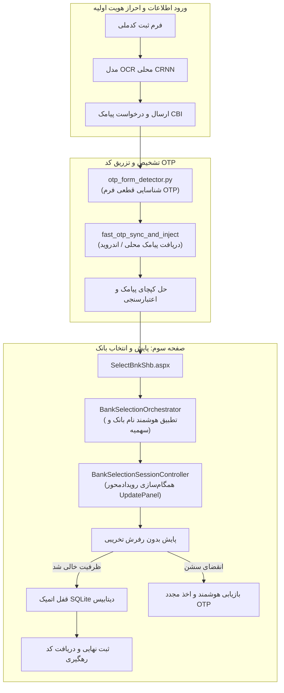

# پاکسازی معماری و تفکیک مسئولیت‌ها (Architecture Cleanup Report)

**تاریخ:** ۲۰۲۶-۱۰-۳۰  
**محیط:** MAHANBOT Enterprise Automation  
**شاخه گیت:** `refactor/mahanbot-deep-cleanup`  

---

## ۱. اصل معماری: یک مسئولیت واحد برای هر عملیات (Single Source of Truth)

پیش از این بازآرایی، در برخی بخش‌های سیستم چندین موتور یا توابع موازی برای یک کار یکسان وجود داشتند. در این فاز، تمام گردش‌کارهای اصلی به یک مسیر اجرایی قطعی متصل شدند:

---

## ۲. اصلاحات اساسی اعمال‌شده در معماری

### ۱) یکپارچه‌سازی تشخیص فرم OTP
- **پیش از این:** در فایل‌های `bot_select_otp.py`، `bot_core.py` و `bot_select.py` توابع متعدد و مستقلی برای بررسی وضعیت فیلد پیامک وجود داشتند که باعث خطای تشخیص در هنگام تغییر نام یا ساختار فیلدها می‌شد.
- **اکنون:** تمامی بررسی‌های فرم پیامک از ماژول اختصاصی `otp_form_detector.py` با کشف زنده DOM، تطبیق فرمت عددی و فریم‌های ایزوله صورت می‌پذیرد.

### ۲) موتور انتخاب و پایش بانک در صفحه ۳
- **پیش از این:** در `bot_select_bank.py`، توابع پراکنده با کدهای قدیمی بیش از ۲۴۰۰ خط انباشته شده بود و `bot_select.py` نیز متدهای واسط تکراری برای فراخوانی آن‌ها نگه داشته بود.
- **اکنون:** هسته پایش و انتخاب بانک به `core/bank_selection/orchestrator.py` و `bank_session_controller.py` منتقل شده و متدهای زائد واسط از `bot_select.py` حذف گردیدند.

### ۳) مدل دومرحله‌ای حل کپچا با بهینه‌سازی CPU
- **پیش از این:** در صورت پایین بودن اطمینان مدل اولیه CRNN، ۳ بار چرخه پیش‌پردازش تکرار می‌شد و سپس به دلیل عدم بررسی به موقع فال‌بک، خطای کاذب ثبت می‌گردید.
- **اکنون:** در صورت پایین بودن اطمینان در اولین دور، فوراً موتور فال‌بک محلی (`ddddocr`) فراخوانی می‌شود و از مصرف بیهوده CPU و تکرار پرهزینه پیش‌پردازش‌ها جلوگیری می‌گردد. همچنین پیش‌بینی‌های با طول خارج از محدوده مجاز (کمتر از ۴ یا بیشتر از ۸ نویسه) پیش از بازگشت فیلتر می‌شوند.

### ۴) ایزوله‌سازی نشست‌ها و قفل اتمیک ثبت نهایی
- جلوگیری قطعی از ارسال دوباره فرم ثبت نهایی با تراکنش فوری `BEGIN IMMEDIATE` در SQLite.
- محافظت از پروفایل مرورگر هر متقاضی به صورت مستقل؛ هیچ داده‌ای از متقاضی دیگر در کانتکست مرورگر تداخل نخواهد داشت.
