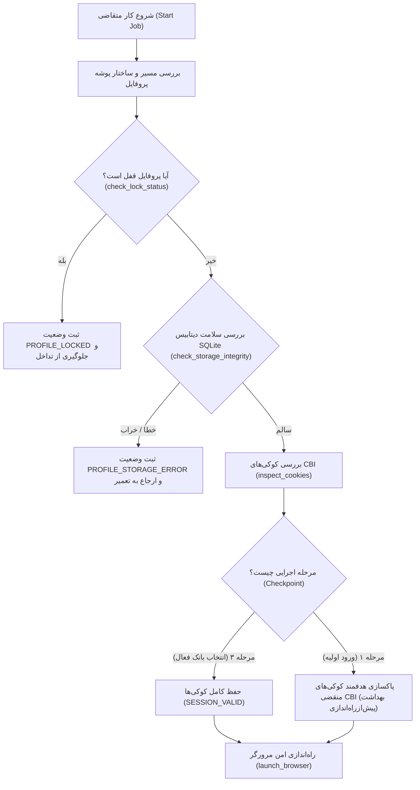

# مستند معماری و طراحی ماژول سلامت پروفایل مرورگر (BrowserProfileHealthManager)

## ۱. هدف و جایگاه ماژول

ماژول مرکزی `BrowserProfileHealthManager` در لایه هسته (`core/browser_profile_health.py`) پیاده‌سازی شده است تا به عنوان مرجع تصمیم‌گیری، پایش و ارزیابی وضعیت سلامت پروفایل‌های مرورگر Chromium، فایل‌های ذخیره‌سازی، قفل‌های همزمانی، کوکی‌ها و نشست‌های کاری متقاضیان عمل نماید.

این سیستم مانع از تخریب کورکورانه داده‌ها می‌شود و وضعیت نشست را با شواهد واقعی دیتابیس، دیسک و شبکه مشخص می‌کند.

---

## ۲. وضعیت‌های استاندارد سلامت (ProfileHealthStatus)

| وضعیت | کد فنی | تعریف و مفهوم معماری |
| :--- | :--- | :--- |
| **سالم و آماده** | `HEALTHY` | پروفایل فاقد قفل فرآیندی است، فایل‌های ذخیره‌سازی معتبرند و آماده شروع کار می‌باشد. |
| **نشست معتبر مرحله ۳** | `SESSION_VALID` | متقاضی دارای نشست احرازشده در صفحه انتخاب بانک (`SelectBnkShb.aspx`) است؛ هرگونه پاکسازی کوکی ممنوع است. |
| **نشست منقضی‌شده** | `SESSION_EXPIRED` | سشن مرحله ۳ منقضی شده و کاربر باید مجدداً وارد چرخه دریافت پیامک شود. |
| **نیازمند احراز مجدد** | `SESSION_REAUTH_REQUIRED` | کوکی‌های منقضی مرحله ۱ در دیسک شناسایی شده و پیش از اجرا باید بهداشت سشن اعمال گردد. |
| **پروفایل قفل‌شده** | `PROFILE_LOCKED` | فایل `SingletonLock` یا قفل انحصاری سیستم‌عامل روی پایگاه‌داده وجود دارد؛ فرآیند دیگر در حال استفاده است. |
| **خطای ذخیره‌سازی دیسک** | `PROFILE_STORAGE_ERROR` | پایگاه‌داده SQLite دیسک آسیب دیده و نیازمند بازسازی ایمن با پشتیبان است. |
| **خطای فرم CAPTCHA** | `CAPTCHA_FORM_ERROR` | تصویر کپچا بارگذاری نشده یا فرم صفحه در DOM دچار اختلال است. |
| **رد درخواست توسط سرور** | `SERVER_REJECTED` | فایروال F5 BIG-IP WAF درخواست را رد کرده و Support ID تولید نموده است. |
| **چالش امنیتی فایروال** | `SECURITY_CHALLENGE` | سامانه نیازمند حل چالش امنیتی یا ورود دستی است. |
| **نامشخص** | `UNKNOWN` | اطلاعات کافی برای تعیین وضعیت وجود ندارد. |

---

## ۳. چرخه ارزیابی سلامت هنگام شروع متقاضی

هنگامی که یک متقاضی در صف قرار می‌گیرد یا راه‌اندازی می‌شود:



---

## ۴. داده‌ساختار گزارش سلامت (ProfileHealthReport)

```python
@dataclass
class ProfileHealthReport:
    nid: str
    health_status: ProfileHealthStatus
    session_status: str
    browser_status: str
    is_locked: bool
    lock_reason: Optional[str] = None
    storage_integrity: str = "ok"
    cookie_count: int = 0
    has_cbi_cookies: bool = False
    has_expired_cbi_cookies: bool = False
    last_successful_login: Optional[float] = None
    last_error: Optional[str] = None
    captcha_status: str = "OK"
    reauth_required: bool = False
    disk_size_bytes: int = 0
    file_count: int = 0
    details: Dict[str, Any] = field(default_factory=dict)
    checked_at: float = field(default_factory=time.time)
```

---

## ۵. تعامل با دیتابیس مرکزی

گزارش‌های سلامت از طریق متدهای:
- `BrowserProfileHealthManager.save_report(report)`
- `BrowserProfileHealthManager.get_report(nid)`
- `BrowserProfileHealthManager.list_all_reports()`

در جدول `profile_health` در `cbi_ultimate.db` ذخیره و همگام می‌شوند و مستقیماً داده‌های داشبورد وب را تغذیه می‌کنند.
