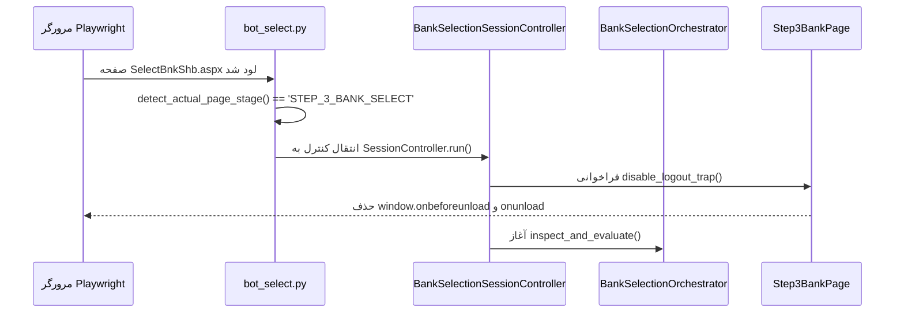

# راهنمای جامع معماری و کلیه حالت‌های صفحه سوم (انتخاب بانک و شعبه)
**صفحه هدف:** `https://ve.cbi.ir/SelectBnkShb.aspx`  
**ماژول‌های اجرایی:** `core/bank_selection/`, `bank_session_controller.py`, `core/step3_bank_page.py`, `bot_select.py`  

---

## ۱. لحظه ورود به صفحه سوم (Entry Flow & Handover)

به محض این که مرورگر مرحله تایید پیامک (OTP) را پشت سر می‌گذارد یا مستقیماً وارد `SelectBnkShb.aspx` می‌شود، توالی اقدامات زیر در کمتر از ۵۰ میلی‌ثانیه رخ می‌دهد:



### ۱.۱. کدهای خنثی‌سازی ترپ خروج (`disable_logout_trap`)
سامانه بانک مرکزی دارای یک اسکریپت تله خروج است که در صورت هرگونه رفرش یا جابجایی در صفحه، سشن ASP.NET را فوراً منهدم کرده و کاربر را لاگ‌اوت می‌کند.  
در فایل `core/step3_bank_page.py`:
```python
def disable_logout_trap(self, page) -> bool:
    """Neutralize CBI unload/beforeunload logout traps immediately upon entering Step 3."""
    script = """() => {
        try {
            window.onbeforeunload = null;
            window.onunload = null;
            if (window.jQuery) {
                jQuery(window).off('beforeunload');
                jQuery(window).off('unload');
            }
            return true;
        } catch(e) { return false; }
    }"""
    return bool(page.evaluate(script))
```

### ۱.۲. تایید صحت هویت متقاضی در DOM
برای جلوگیری از تداخل سشن یا کوکی متقاضیان قبلی:
```python
observed_nid = page.locator("#ctl00_ContentPlaceHolder1_tbIDNo").input_value()
if observed_nid and observed_nid != str(bot.nid):
    # مغایرت هویتی؛ خروج ایمن جهت حفظ امنیت داده‌ها
    return "applicant_identity_mismatch"
```

---

## ۲. هماهنگ‌سازی شهر و پست‌بک ASP.NET (`PostbackSynchronizer`)

اگر متقاضی شهر خاصی را مدنظر داشته باشد، دراپ‌داون `#ctl00_ContentPlaceHolder1_ddlCity` بررسی می‌شود. تغییر شهر در CBI از طریق `UpdatePanel2` انجام می‌شود.  
به جای استفاده از خواب‌های صلب (`time.sleep`)، از شیء استاندارد `Sys.WebForms.PageRequestManager` خودِ ASP.NET استفاده می‌شود:

در فایل `core/bank_selection/postback_sync.py`:
```python
class PostbackSynchronizer:
    @staticmethod
    def is_in_postback(page) -> bool:
        return bool(page.evaluate("""() => {
            try {
                if (typeof Sys !== 'undefined' && Sys.WebForms && Sys.WebForms.PageRequestManager) {
                    return Sys.WebForms.PageRequestManager.getInstance().get_isInAsyncPostBack();
                }
            } catch(e) {}
            return false;
        }"""))

    @classmethod
    def select_and_sync(cls, page, selector: str, value: str, timeout_ms: int = 7000) -> bool:
        locator = page.locator(selector).first
        locator.select_option(value=value)
        locator.dispatch_event("change")
        return cls.wait_for_postback_complete(page, timeout_ms=timeout_ms)
```

---

## ۳. پارس کاتالوگ بانک‌ها و وضعیت سهمیه‌ها (`BankCatalogParser`)

گزینه‌های دراپ‌داون `#ctl00_ContentPlaceHolder1_ddlBankName` استخراج و به آبجکت‌های ساختاریافته تبدیل می‌شوند:

```python
# نمونه ساختار استخراج‌شده برای هر گزینه:
BankOptionInfo(
    value="19",                          # کد ثابت بانک (صادرات)
    text="بانک صادرات ایران [دارای ظرفیت ثبت نام] متقاضی در صف : 1,250 نفر",
    clean_title="بانک صادرات ایران",     # نام پالایش‌شده فارسی
    has_active_quota=True,               # دارای ظرفیت قطعی
    is_reserve=False,                    # حالت رزرو نیست
    waiting_count=1250                   # تعداد متقاضیان در صف
)
```

---

## ۴. ماتریس تمام حالت‌های تصمیم‌گیری در صفحه سوم

| حالت | شرط وضعیت | رفتار سیستم و کدهای متناظر | خروجی نهایی |
| :---: | :--- | :--- | :--- |
| **۱** | **ظرفیت قطعی + تیک ثبت نهایی روشن** | انتخاب بانک در `ddlBankName` -> هماهنگ‌سازی پست‌بک -> کلیک `#ctl00_ContentPlaceHolder1_btnSave` -> استخراج کد رهگیری | `confirmed` (کد رهگیری ثبت شد) |
| **۲** | **ظرفیت قطعی + تیک ثبت نهایی خاموش** | انتخاب انجام نمی‌شود -> ثبت وضعیت `FINAL_SUBMIT_READY` -> انتظار تایید دستی کاربر | `waiting` (آماده تایید کاربر) |
| **۳** | **سهمیه رزرو + هر دو تیک روشن** | انتخاب بانک رزرو -> ارسال فرم نهایی با فلگ `reserve_confirmed=True` | `confirmed` (کد رزرو ثبت شد) |
| **۴** | **سهمیه رزرو اما تیک رزرو خاموش** | از ثبت رزرو صرف‌نظر شده و پایش ادامه می‌یابد تا سهمیه قطعی باز شود | `waiting` (ادامه پایش) |
| **۵** | **خطای ظرفیت غیرحضوری پر است** | سامانه پیام خطای غیرحضوری می‌دهد -> بلافاصله کلیک `#ctl00_ContentPlaceHolder1_rbtnHozori` (ثبت حضوری) -> سابمیت مجدد | اخذ کد رهگیری حضوری |
| **۶** | **عدم وجود ظرفیت برای بانک مدنظر** | اگر مهلت پیامک باقی باشد (< ۱۱۵ ثانیه): پایش چرخشی ۵ ثانیه‌ای بدون خروج از سشن.<br>اگر پیامک منقضی شود: اجرای `Warm Tab Handover`. | `cycle_otp` یا `waiting` |
| **۷** | **چالش فایروال یا رد درخواست WAF** | تشخیص پیام رد درخواست یا لود المنت `#ans` -> توقف فوری و اعلام `WAF_BLOCKED` در پنل | `stopped` (محافظت از IP) |
| **۸** | **انقضای سشن (Session Expired)** | دریافت پیام انقضای سشن از سرور -> پاکسازی قفل‌ها و بازگشت به مرحله ۱ جهت اخذ پیامک جدید | `reauthenticate` |

---

## ۵. جزئیات سازوکار Warm Tab Handover (تمدید بدون قطعی سشن)

هنگامی که مهلت پیامک جاری (معمولاً ۱۱۵ تا ۱۲۰ ثانیه) تمام می‌شود:
1. تب جدیدی در همان کانتکست مرورگر باز می‌شود (`context.new_page()`).
2. به `SelTasCase.aspx` می‌رود، کد ملی را وارد و کپچای مرحله ۱ را حل می‌کند تا پیامک جدید صادر شود.
3. تب قبلی بدون بستن کل مرورگر بسته می‌شود (`old_page.close()`).
4. متقاضی بدون لحظه‌ای وقفه آماده دریافت پیامک دوم و ادامه پایش می‌شود.
