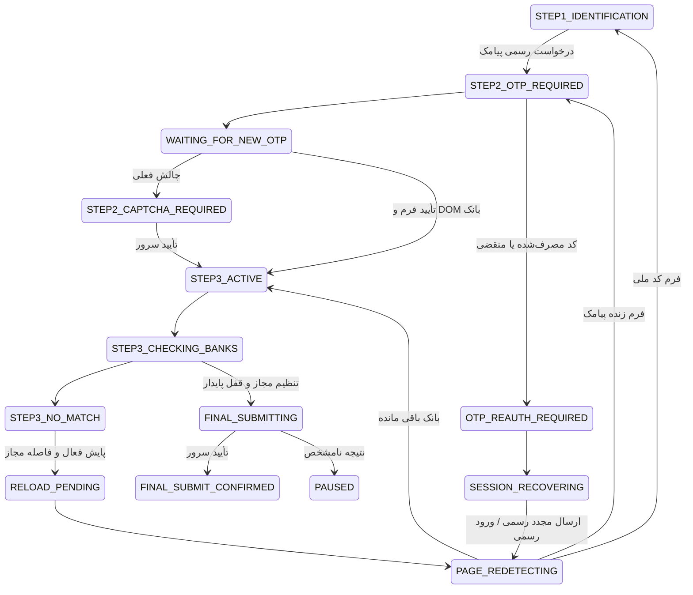

# گردش کار واحد و انتقال‌ها

منبع حقیقت چرخه و جدول انتقال: `core/loan_workflow.py`، کلاس `LoanWorkflow` و
`TRANSITIONS`. وضعیت قدیمی صف/بانک برای سازگاری باقی است و وضعیت تفصیلی جدید
در `runtime.workflow_state` قرار می‌گیرد. منطق OTP و بازیابی مسیر موازی ندارد.

| گروه | وضعیت‌ها |
|---|---|
| مرحله اول | STEP1_IDENTIFICATION، STEP1_CAPTCHA_REQUIRED |
| مرحله دوم | STEP2_OTP_REQUIRED، STEP2_CAPTCHA_REQUIRED، STEP2_READY_TO_CONTINUE، OTP_REAUTH_REQUIRED، WAITING_FOR_NEW_OTP |
| مرحله سوم | STEP3_ACTIVE، STEP3_CHECKING_BANKS، STEP3_QUOTA_AVAILABLE، STEP3_NO_MATCH |
| ناوبری | RELOAD_PENDING، PAGE_REDETECTING |
| نشست | SESSION_EXPIRED، SESSION_RECOVERING |
| ارسال نهایی | FINAL_SUBMIT_PENDING، FINAL_SUBMITTING، FINAL_SUBMIT_CONFIRMED |
| کنترل | UNKNOWN، PAUSED، FAILED |

جدول اجرایی انتقال‌ها برای تمام وضعیت‌ها تعریف می‌شود؛ انتقال نامعتبر `ValueError`
می‌دهد. مشاهده DOM می‌تواند از PAGE_REDETECTING به مرحله واقعی برود؛ این اجازه
تشخیص، مجوز ارسال فرم یا تکرار درخواست نیست. FINAL_SUBMIT_CONFIRMED پایانی است.

تشخیص `WorkflowDetection` شامل state، confidence، URL بدون query/fragment،
detected_fields بدون مقدار، visible_errors طبقه‌بندی‌شده، session_status، reason
و elapsed_ms است. URL به‌تنهایی مرحله را تعیین نمی‌کند. خطای ۴۰۱ انقضا، ۴۰۳/۴۲۹
توقف و خطای ۵xx وضعیت نامشخص ایجاد می‌کند. UNKNOWN کلیک حدسی ایجاد نمی‌کند.

confidence امتیاز ابتکاری شواهد DOM است، نه احتمال آماری کالیبره‌شده با داده میدانی.

checkpoint دارای وضعیت، علت، زمان، diagnostic ایمن و حداکثر ۲۰ انتقال آخر است.
مرورگر همیشه از `BrowserSessionOwner` گرفته می‌شود؛ فرمان HTTP فقط در صف قرار می‌گیرد.
