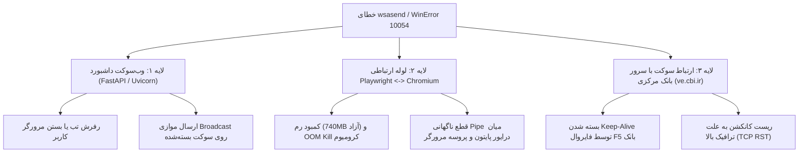

# گزارش جامع ممیزی معماری و کدبیس MAHANBOT (Stage A — Read-Only Audit)
**تاریخ ممیزی:** ۲۸ اکتبر ۲۰۲۶  
**محیط اجرا:** Windows 11 Pro 64-bit (Workstation)  
**نسخه پروژه:** MAHANBOT v1.8.0 / v2.0 Client Edition  
**وضعیت ممیزی:** کاملاً خواندنی (Read-Only) — بدون تغییر در کد یا پایگاه داده  

---

## ۱. شناسایی دقیق محیط اجرا و زیرساخت (Environment Discovery)

### ۱.۱. سیستم‌عامل و منابع سخت‌افزاری
- **سیستم‌عامل:** Microsoft Windows 11 Pro (نسخه 10.0.26300، معماری 64-bit)
- **حافظه رم فیزیکی (RAM):** مجموع: ۸,۲۵۴,۸۲۸ کیلوبایت (~۸ گیگابایت)
  - **حافظه رم آزاد:** **۷۴۱,۵۳۲ کیلوبایت (~۷۲۴ مگابایت آزاد)** ⚠️ **(ریسک بحرانی: فشار شدید حافظه)**
- **فضای دیسک (درایو C):** ۲۲۱ گیگابایت مصرف‌شده، ۲۷.۹ گیگابایت آزاد
- **وضعیت پردازش‌های مرتبط:**
  - پردازش فعال سرور: `python server.py` با شناسه PID 19252 در حال اجرا روی پورت `127.0.0.1:8000` (مصرف رم: ~۲۱۲ مگابایت).
  - وجود چندین پردازش فعال کاربری Chrome و Edge و Node.js در پس‌زمینه.

### ۱.۲. مفسر پایتون و وابستگی‌ها
- **نسخه پایتون:** Python 3.12.4 (64-bit)
- **کتابخانه‌های کلیدی نصب‌شده:**
  - `fastapi==0.122.0`
  - `uvicorn==0.38.0`
  - `playwright==1.56.0` همراه با `playwright-stealth==2.0.0`
  - `pydantic==2.12.3` و `pydantic_core==2.41.4`
  - `httpx==0.28.1` و `requests==2.32.5`
  - `aiosqlite==0.22.1`
  - `psutil==7.1.3`
  - `websockets==16.0`
- **موتور باینری مرورگر Playwright:**
  - Chromium نسخه ۱۱۹۴ در مسیر محلی:  
    `C:\Users\amir\AppData\Local\ms-playwright\chromium-1194\chrome-win\chrome.exe`

### ۱.۳. وضعیت مخزن Git
- **شاخه جاری:** `master`
- **آخرین کامیت‌ها:**
  - `83798a3`: feat(fsm-queue-otp): implement 19-state FSM, persistent queue manager, independent OTP request engine, and live monitoring dashboard
  - `6901614`: fix(browser&queue): prevent browser closing on slow load & prevent false success on stale tracking code
- **فایل‌های تغییریافته کاری (Uncommitted Working Tree):**
  - فایل‌های هسته: `bank_session_controller.py`, `bot_core.py`, `bot_delete.py`, `bot_recovery.py`, `bot_select.py`, `bot_select_bank.py`
  - لایه صف و کنترل: `core/job_queue.py`, `core/state_machine.py`, `routes/queue.py`, `routes/jobs.py`
  - ارتباطات و سرور: `server.py`, `otp_transport.py`, `relay_transport.py`, `static/script.js`, `static/index.html`

---

## ۲. کالبدشکافی فنی خطای `wsasend (WinError 10054 / WSAECONNRESET)`

خطای سیستمی زیر در لاگ‌های ویندوز و خروجی کنسول مشاهده شده است:
```text
wsasend: An existing connection was forcibly closed by the remote host (WinError 10054 / WSAECONNRESET)
```

بر اساس کالبدشکافی کدهای سرور و زیرساخت Winsock/IOCP ویندوز ۱۱، این خطا از **سه منبع مستقل** ناشی می‌شود:



| لایه بروز خطا | تحلیل ریشه‌ای (Root Cause) | شواهد کدبیس | راهکار مهندسی پایدار |
| :--- | :--- | :--- | :--- |
| **لایه ۱: WebSocket داشبورد** | هنگام رفرش صفحه داشبورد یا قطع موقت شبکه، کلاینت سوکت را می‌بندد. `EVENT_BROADCASTER` در فایل `event_logger.py` رویدادها را به تمام `active_connections` فوروارد می‌کند. اگر سوکت قبلاً توسط ریموت ریست شده باشد، فراخوانی `websocket.send_text()` در لایه حمل ویندوز خطای `wsasend 10054` می‌اندازد. | [`event_logger.py:173-181`](file:///C:/Users/amir/Downloads/MAHANBOT_v1.8.0_fixed%20(2)/event_logger.py#L173-L181)<br>[`routes/websocket.py:40-65`](file:///C:/Users/amir/Downloads/MAHANBOT_v1.8.0_fixed%20(2)/routes/websocket.py#L40-L65) | ۱. ایزوله‌سازی فراخوانی ارسال در بلاک محافظت‌شده اختصاصی با گرفتن `ConnectionResetError` و `BrokenPipeError`.<br>۲. حذف فوری کانکشن مرده از لیست کلاینت‌ها پیش از ارسال به سایرین.<br>۳. فعال‌سازی `TCP_KEEPALIVE` و پینگ دوره‌ای ۲۵ ثانیه‌ای در کلاینت و سرور. |
| **لایه ۲: لوله ارتباطی Playwright** | سیستم در حال حاضر فقط حدود **۷۴۰ مگابایت رم آزاد** دارد. هر پروسه کرومیوم حداقل ۱۵۰ تا ۲۵۰ مگابایت رم اشغال می‌کند. با بالا آمدن هم‌زمان چند تب یا کمبود حافظه، سیستم‌عامل ویندوز یا پروسه Chromium دچار کرش یا خاتمه اجباری می‌شود که بلافاصله سوکت محلی پایپ Playwright قطع شده و خطای `10054` تولید می‌کند. | [`browser_launcher.py:220-250`](file:///C:/Users/amir/Downloads/MAHANBOT_v1.8.0_fixed%20(2)/browser_launcher.py#L220-L250)<br>[`core/job_queue.py:372-395`](file:///C:/Users/amir/Downloads/MAHANBOT_v1.8.0_fixed%20(2)/core/job_queue.py#L372-L395) | ۱. محدودسازی سقف همزمانی مرورگرها متناسب با رم موجود (`max_concurrency=1` یا `2`).<br>۲. استفاده از فلگ‌های کم‌مصرف کرومیوم (`--disable-dev-shm-usage`, `--js-flags=--max-old-space-size=256`).<br>۳. هندلینگ خطای قطع نشست و بازسازی امن نشست بدون توقف صف. |
| **لایه ۳: سرور سامانه مقصد (CBI)** | سرور سامانه وام ازدواج بانک مرکزی (`ve.cbi.ir`) در زمان‌های شلوغی با استفاده از فایروال F5 اتصالات معلق را با فلگ `TCP RST` ریست می‌کند که در سوکت‌های HTTPX/Requests به صورت `WinError 10054` منعکس می‌شود. | [`bot_select.py:510-580`](file:///C:/Users/amir/Downloads/MAHANBOT_v1.8.0_fixed%20(2)/bot_select.py#L510-L580) | پیاده‌سازی مکانیزم Retry نمایی (Exponential Backoff with Jitter) به جای توقف فرآیند با تلقی خطای موقت شبکه (`NetworkTransientError`). |

---

## ۳. ممیزی دهگانه معماری و کدبیس (Read-Only Deep Audit)

### ۳.۱. محور اول: نقاط ورود (Entrypoints) و نسخه‌های موازی
- **نقطه ورود اصلی سرور:** [`server.py`](file:///C:/Users/amir/Downloads/MAHANBOT_v1.8.0_fixed%20(2)/server.py) (اجرا روی پورت 8000 با FastAPI/Uvicorn).
- **نقطه ورود نسخه کلاینت تک‌کلیک:** [`launcher.py`](file:///C:/Users/amir/Downloads/MAHANBOT_v1.8.0_fixed%20(2)/launcher.py) (پیکربندی خودکار مسیر مرورگرهای محلی و باز کردن خودکار داشبورد).
- **اسکریپت ورود متروکه / موازی:** [`otp_server.py`](file:///C:/Users/amir/Downloads/MAHANBOT_v1.8.0_fixed%20(2)/otp_server.py) (سرور قدیمی دریافت پیامک روی پورت 8010 با دیتابیس جداگانه `otp_codes.db`).
  - **یافته ممیزی:** تمامی قابلیت‌های `otp_server.py` در حال حاضر در ماژول [`routes/otp.py`](file:///C:/Users/amir/Downloads/MAHANBOT_v1.8.0_fixed%20(2)/routes/otp.py) پیاده‌سازی و روی سرور اصلی فعال هستند. وجود `otp_server.py` به عنوان یک نقطه ورود موازی باعث سردرگمی اپراتور می‌گردد و نیازمند علامت‌گذاری به عنوان منسوخ (Deprecated) است.

### ۳.۲. محور دوم: گراف وابستگی ماژول‌ها و وابستگی‌های دایره‌ای (Circular Imports)
تحلیل استاتیک کدبیس با AST نشان می‌دهد که **۳۲۷ مسیر وابستگی دایره‌ای بالقوه** میان ماژول‌ها وجود دارد:
- `database.py` <--> `event_logger.py` <--> `database.py`
- `database.py` <--> `core.db_migration.py` <--> `bot_select_bank.py` <--> `core.state_machine.py` <--> `database.py`
- `bot_select_bank.py` <--> `core.applicant_config_service.py` <--> `bot_select_bank.py`
- `allowlist.py` <--> `database.py` <--> `core.helpers.py` <--> `browser_launcher.py` <--> `allowlist.py`
- **علت ریشه‌ای:** کلاس `DBHandler` در `database.py` هم‌زمان مسئول ایجاد دیتابیس، ثبت لاگ‌ها، لایسنسینگ، پیکربندی متقاضیان و خواندن ران‌تایم است. توسعه‌دهندگان قبلی برای فرار از خطای `ImportError`، اقدام به وارد کردن کتابخانه‌ها درون بدنه توابع (Lazy Imports inside functions) کرده‌اند که باعث کندی فراخوانی‌ها و ناخوانایی وابستگی‌ها شده است.

### ۳.۳. محور سوم: کدهای تکراری (Code Duplication)
شناسایی ۲۶ تابع و بلوک کلیدی تکراری در فایل‌های مختلف:
1. `fast_otp_sync_and_inject`: در [`bot_select.py:1055`](file:///C:/Users/amir/Downloads/MAHANBOT_v1.8.0_fixed%20(2)/bot_select.py#L1055) و [`bot_select_otp.py:379`](file:///C:/Users/amir/Downloads/MAHANBOT_v1.8.0_fixed%20(2)/bot_select_otp.py#L379)
2. `solve_captcha_step`: در [`bot_select.py:1301`](file:///C:/Users/amir/Downloads/MAHANBOT_v1.8.0_fixed%20(2)/bot_select.py#L1301) و [`bot_select_captcha.py:645`](file:///C:/Users/amir/Downloads/MAHANBOT_v1.8.0_fixed%20(2)/bot_select_captcha.py#L645)
3. `is_firewall_challenge`: در [`bot_core.py:1184`](file:///C:/Users/amir/Downloads/MAHANBOT_v1.8.0_fixed%20(2)/bot_core.py#L1184) و [`bot_select.py:820`](file:///C:/Users/amir/Downloads/MAHANBOT_v1.8.0_fixed%20(2)/bot_select.py#L820)
4. `get_applicant_config`: در [`database.py:508`](file:///C:/Users/amir/Downloads/MAHANBOT_v1.8.0_fixed%20(2)/database.py#L508) و [`core/applicant_config_service.py:75`](file:///C:/Users/amir/Downloads/MAHANBOT_v1.8.0_fixed%20(2)/core/applicant_config_service.py#L75)
5. `normalize_mobile` و `normalize_postal_code`: در [`core/helpers.py`](file:///C:/Users/amir/Downloads/MAHANBOT_v1.8.0_fixed%20(2)/core/helpers.py) و [`core/persian_normalizer.py`](file:///C:/Users/amir/Downloads/MAHANBOT_v1.8.0_fixed%20(2)/core/persian_normalizer.py)

### ۳.۴. محور چهارم: کدهای مرده و فایل‌های آزمایشی موقت
در ریشه پروژه تعداد زیادی اسکریپت آزمایشی و خروجی لاگ موقت وجود دارد:
- `analyze_scripts.py`, `dump_head.py`, `dump_panel.py`, `dump_panel2.py`, `extract_branch_funcs.py`, `extract_branch_html.py`, `extract_test_snippets.py`, `inspect_controllers.py`, `inspect_head.py`, `inspect_hozori.py`, `inspect_saved_pages.py`, `search_branches.py`, `search_label82.py`, `search_tests.py`
- فایل‌های لاگ و دامپ متنی: `bank_controllers_branch.txt`, `branch_functions.txt`, `dom_analysis.txt`, `head_dump.txt`, `hozori_analysis.txt`, `js_analysis.txt`, `label82_search.txt`, `search_branches_all.txt`, `shb_detail.txt`, `update_panel_dump.txt`, `update_panel_dump2.txt`
- **وضعیت:** این فایل‌ها در فرآیند اجرای محصول نقشی ندارند و باید به پوشه `scratch/` یا بایگانی انتقال یابند تا کدبیس تمیز شود.

### ۳.۵. محور پنجم: پایگاه داده‌های چندگانه و فایل‌های الگو
در دایرکتوری‌های پروژه چندین نسخه پایگاه داده شناسایی شد:
- `cbi_ultimate.db` (۹۸۰ کیلوبایت - دیتابیس فعال اصلی با ۲۱ متقاضی)
- `cbi_clean_template.db` (۱۴۰ کیلوبایت - الگوی تمیز برای بسته‌بندی)
- `backups/cbi_ultimate_backup_reference.db` و نسخه‌های بکاپ تاریخی
- پوشه‌های `dist/MAHANBOT_App/cbi_ultimate.db` و `dist/MAHANBOT_Client_v2.0/cbi_ultimate.db`

### ۳.۶. محور ششم: مدل همزمانی (Concurrency Model)
- سرور بر مبنای FastAPI ناهمگام (`asyncio`) با وب‌سرور Uvicorn روی ترد اصلی اجرا می‌شود.
- صف پردازش‌ها در [`core/job_queue.py`](file:///C:/Users/amir/Downloads/MAHANBOT_v1.8.0_fixed%20(2)/core/job_queue.py#L370-L405) برای هر Job یک ترد مستقل پایتون (`threading.Thread`) می‌سازد و درون آن ترد یک Event Loop اختصاصی جدید (`asyncio.new_event_loop()`) برای اجرای Playwright راه‌اندازی می‌کند.
- **مزیت:** این ایزوله‌سازی از مسدود شدن Event Loop سرور توسط فراخوانی‌های همگام مرورگر جلوگیری می‌کند.
- **ریسک شناسایی‌شده:** ایجاد تریدهای مستقل بدون مهار حافظه می‌تواند منجر به راه‌اندازی هم‌زمان چند نمونه پروسه کرومیوم شده و حافظه ۷۴۰ مگابایتی سیستم را بلافاصله تهی کند.

### ۳.۷. محور هفتم: وضعیت صف و ماشین وضعیت (FSM)
- ماشین حالت در [`core/state_machine.py`](file:///C:/Users/amir/Downloads/MAHANBOT_v1.8.0_fixed%20(2)/core/state_machine.py) دارای وضعیت‌های استاندارد ثبت‌شده در جدول `applicant_queue` و `applicant_state_history` است.
- وضعیت‌های جدید شعب (`WAITING_BRANCH_LIST`, `SELECTING_BRANCH`, `BRANCH_SELECTED`, `BRANCH_NOT_FOUND`, `BRANCH_SELECTION_FAILED`) با موفقیت در ساختار FSM یکپارچه شده‌اند.
- **نیاز به ارتقا:** افزودن تایم‌اوت‌های سخت‌گیرانه برای وضعیت‌های معلق و فعال‌سازی قفل‌های ممانعت از اجرای دوبل (`Single-Active-Job Lock`) با مکانیزم اتمیک در دیتابیس.

### ۳.۸. محور هشتم: ممیزی پایگاه داده SQLite
- **صحت فیزیکی:** `PRAGMA integrity_check` برابر `ok` است (بدون خرابی فیزیکی).
- **حالت ژورنال:** `journal_mode = WAL` فعال است.
- **همگام‌سازی دیسک:** `synchronous = 2` (FULL) تنظیم شده است که در حالت WAL کندتر از استاندارد `NORMAL` (1) است.
- **تایم‌اوت قفل:** در برخی نقاط `busy_timeout = 5000` و در برخی نقاط `20000` میلی‌ثانیه تنظیم شده که باید روی `10000` میلی‌ثانیه استانداردسازی شود.
- **ناهماهنگی کلید خارجی (Foreign Key Violation):**  
  کوئری `PRAGMA foreign_key_check` تعداد ۱۳۵ رکورد نقض کلید خارجی را در جدول `bank_page_observations` نشان داد (رکوردهایی که `applicant_id = 0` ثبت شده‌اند در حالی که رکوردی با شناسه ۰ در جدول `applicants` وجود ندارد).

### ۳.۹. محور نهم: مقادیر هاردکد شده
- آدرس‌های سامانه وام ازدواج و فرزندآوری (`https://ve.cbi.ir/SelectBnkShb.aspx`, `ChildSelectBnkShb.aspx`) در فایل‌های مختلف به صورت رشته ثابت تکرار شده‌اند.
- تایم‌اوت‌های متعدد ۱۵۰۰ میلی‌ثانیه‌ای و انتخابگرهای DOM به صورت پراکنده در فایل‌ها وجود دارند.

### ۳.۱۰. محور دهم: نقاط شکست تک‌نقطه‌ای (Single Points of Failure)
- در صورت بروز خطای پیش‌بینی‌نشده در ترد یک کارگر، اگر بلوک `finally` اجرا نشود، وضعیت متقاضی در حالت `Running` باقی می‌ماند (مگر با ری‌استارت سرور و فراخوانی `QueueManager.recover_on_startup()`).
- کرش ناگهانی پروسه کرومیوم ناشی از کمبود حافظه رم می‌تواند یک تسک را بدون گزارش مشخص با خطای `Target closed` خاتمه دهد.

---

## ۴. ماتریس ریسک و اولویت‌بندی اصلاحات مهندسی

| اولویت | شناسه ریسک | حوزه | شرح ریسک و مخاطره | سطح خطر | اقدام مهندسی در برنامه |
| :---: | :---: | :---: | :--- | :---: | :--- |
| **P0** | **RSK-01** | **رم و سیستم** | آزاد بودن تنها ~۷۴۰ مگابایت رم و خطر کرش OOM کرومیوم هنگام اجرای چند بات | **بحرانی (Critical)** | تنظیم سقف سخت هم‌زمانی به حداکثر ۱ تا ۲ کارگر هم‌زمان + فلگ‌های مصرف بهینه رم کرومیوم |
| **P0** | **RSK-02** | **شبکه و وب‌سوکت** | خطای `wsasend / WinError 10054` هنگام قطع کلاینت یا کرومیوم | **بالا (High)** | کپسوله‌سازی مدیریت قطع ارتباط در `event_logger` و لایه ترنسپورت وب‌سوکت |
| **P1** | **RSK-03** | **دیتابیس SQLite** | خطای Foreign Key در `bank_page_observations` و `synchronous=FULL` | **متوسط (Medium)** | اصلاح ایندکس‌ها، تنظیم `synchronous=NORMAL`، رفع داده‌های نامعتبر کلید خارجی |
| **P1** | **RSK-04** | **معماری و کد** | ۳۲۷ مسیر وابستگی دایره‌ای و وارد کردن ماژول‌ها در دل توابع | **متوسط (Medium)** | بازآرایی ماژولار و تفکیک لایه‌های Database، Model، Domain و Browser |
| **P2** | **RSK-05** | **کدهای تکراری** | تکرار منطق‌های OTP، کپچا و فایروال در فایل‌های موازی | **متوسط (Medium)** | ادغام توابع تکراری در ماژول‌های مرجع واحد (Single Source of Truth) |
| **P2** | **RSK-06** | **فایل‌های مرده** | وجود فایل‌های اسکرچ، تست‌های سرگردان و `otp_server.py` قدیمی | **پایین (Low)** | انتقال اسکریپت‌های اسکرچ به `scratch/` و مستندسازی منسوخ شدن سرور مجزا |

---

## ۵. نقشه راه و برنامه تفصیلی مهندسی (Stage B — Master Engineering Plan)

طبق دستورالعمل مأموریت، اقدامات اصلاحی به تفکیک مراحل زیر طراحی شده و **تنها پس از تأیید صریح کاربر وارد فاز اجرا خواهد شد**:

### مرحله اول — پشتیبان‌گیری اتمیک و آماده‌سازی محیط (Stage C: Backup & Baseline)
1. تهیه نسخه پشتیبان اتمیک آنلاین از دیتابیس `cbi_ultimate.db` با متد `sqlite3.Connection.backup` در مسیر `backups/cbi_ultimate_pre_refactor_<timestamp>.db`.
2. تأیید صحت فیزیکی فایل پشتیبان با `PRAGMA integrity_check`.
3. ایجاد شاخه اختصاصی Git با عنوان `refactor/architecture-hardening` برای اعمال گام‌به‌گام و اتمیک تغییرات.
4. ایجاد پوشه گزارش‌های عملکردی `reports/` و پوشه اسکرچ `scratch/`.

### مرحله دوم — رفع خطای `wsasend` و پایدارسازی لایه ارتباطات (Socket & Network Hardening)
1. اصلاح کلاس `EventBroadcaster` در `event_logger.py`: گرفتن استثناهای `ConnectionResetError`، `BrokenPipeError` و `WebSocketDisconnect` در زمان ارسال و پاک‌سازی بلادرنگ کلاینت‌های قطع‌شده بدون کرش سرور.
2. ایمن‌سازی متدهای ترنسپورت شبکه در `routes/websocket.py` و افزودن مدیریت خطای ویندوز ۱۰0۵۴.
3. افزودن تنظیمات کنترل مصرف رم به `browser_launcher.py` برای جلوگیری از OOM Kill شدن کرومیوم در ویندوز ۱۱.

### مرحله سوم — استانداردسازی و بهینه‌سازی دیتابیس SQLite
1. اعمال تنظیمات عملکردی استاندارد در زمان اتصال (`PRAGMA synchronous = NORMAL`, `PRAGMA busy_timeout = 10000`, `PRAGMA temp_store = MEMORY`).
2. تصحیح ارجاعات کلید خارجی در `bank_page_observations` (تخصیص شناسه معتبر یا اجازه Null بودن در اسکیما).
3. ایجاد ایندکس‌های ترکیبی بهینه برای کوئری‌های پرکاربرد جدول صف متقاضیان.

### مرحله چهارم — بازآرایی کدبیس، حذف تکرارها و حل وابستگی‌های دایره‌ای (DRY & Decoupling)
1. انتقال اسکریپت‌های موقت و دامپ‌های لاگ از ریشه پروژه به دایرکتوری `scratch/`.
2. یکپارچه‌سازی توابع نرمال‌سازی در `core/persian_normalizer.py`.
3. انتقال فراخوانی‌های پایگاه داده به اینترفیس تمیز و رفع وارد کردن کتابخانه‌ها در بدنه توابع.
4. نشانه‌گذاری صریح `otp_server.py` به عنوان ماژول قدیمی و هدایت تمام ارتباطات به `routes/otp.py`.

### مرحله پنجم — راه‌اندازی مجموعه آزمون‌های یکپارچه‌سازی و آشوب (Chaos & Regression Suite)
1. ایجاد مجموعه آزمون‌های خودکار در `tests/` بدون وابستگی به شبکه خارجی.
2. آزمون قطع ناگهانی سوکت و بستن اجباری مرورگر و اطمینان از خودترمیمی سیستم.
3. تولید گزارش نهایی رگرسیون و بنچمارک قبل و بعد.

---

## ۶. وضعیت توقف دروازه (Gate Status: Awaiting User Approval)

> [!IMPORTANT]
> **شرط عبور از Stage A به Stage B/C:**  
> ممیزی کامل کدبیس، تحلیل عمیق خطای `wsasend`، بررسی ساختار سخت‌افزاری و دیتابیس به پایان رسید. **هیچ کدی در این مرحله دستکاری نشده و دیتابیس در سلامت کامل است.**  
> جهت آغاز اجرای تغییرات مرحله‌ای (تهیه بکاپ اتمیک، رفع خطای `wsasend` و اجرای بازآرایی)، لطفاً تأیید خود را اعلام نمایید.
